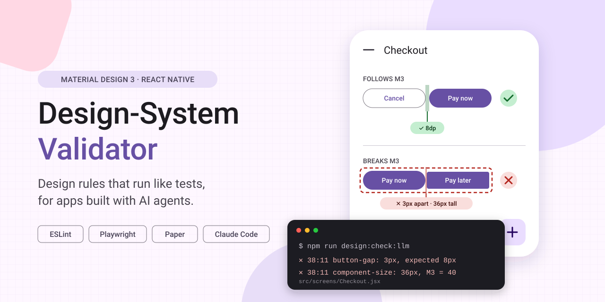
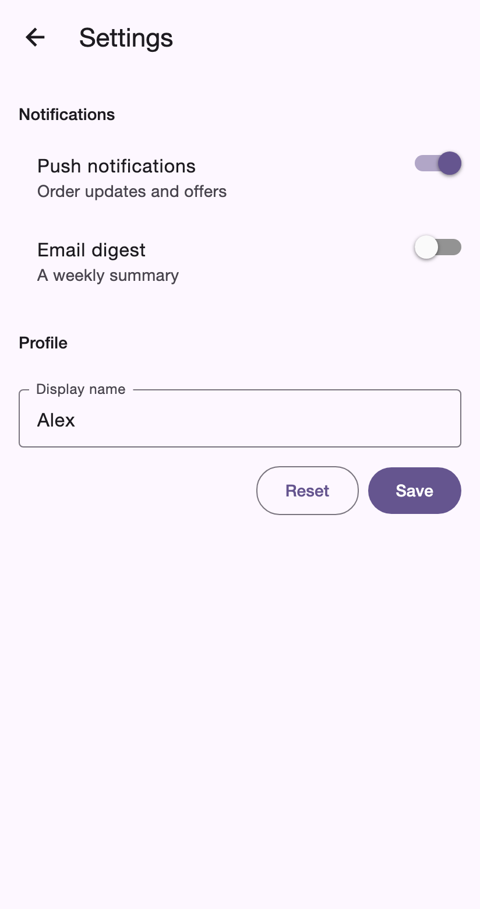
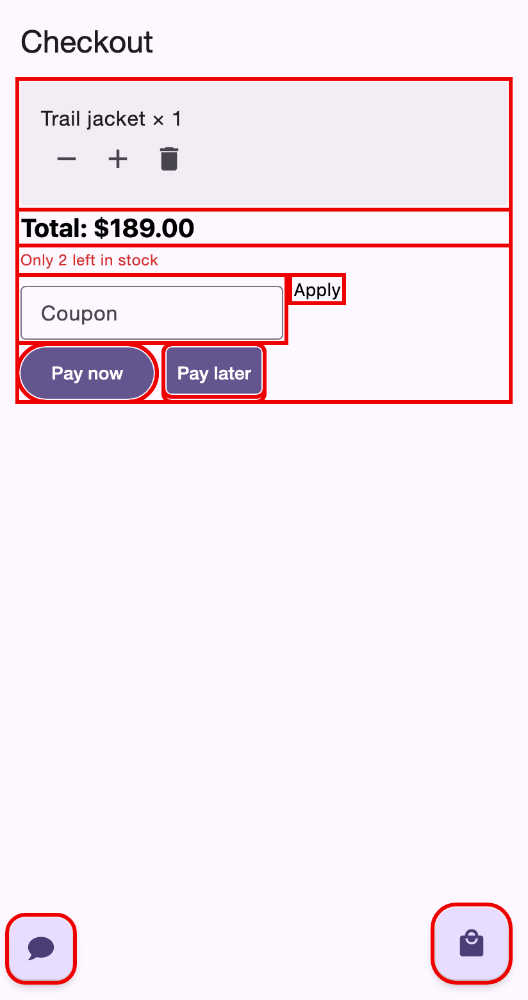

# React Native Design System Validator

> A React Native project that runs an automatic design system validator (using Material Design 3).



**Design-system rules that run like tests.** This project checks that a React Native +
[react-native-paper](https://callstack.github.io/react-native-paper/) app actually follows
[Material Design 3](https://m3.material.io): spacing, sizes, corner shapes, type scale, touch targets,
dialog layout and more. Every check is a plain script. No AI judges the result, so the same code
always gives the same answer.

It is the React Native port of [react-design-system-validator](https://github.com/AlexBrou/react-design-system-validator)
(React + MUI). It is built for designers who create apps directly with AI coding agents (such as Claude Code)
instead of drawing them in Figma. The agent writes the screens, the validator tells it exactly
what breaks the design system and where, and the agent fixes it.

[](LICENSE)

| A screen that follows M3 | A screen that breaks it, with every violation outlined |
|---|---|
|  |  |

```
$ npm run design:check:llm
design:check FAIL — 35 violations in 2 files. Fix the code; do not edit design-rules/ or add ignores.
src/screens/Checkout.jsx
  18:15 touch-target: IconButton "Decrease" and IconButton "Increase" have overlapping 48x48 touch targets (8px overlap)
  30:13 no-native-controls: <TouchableOpacity> from 'react-native' bypasses the design system. Use Button / IconButton / TouchableRipple from react-native-paper.
  37:13 component-size: Button "Pay later" is 36px tall; M3 Button allows 40px
  43:7 single-fab: 2 FABs on screen; M3 allows 1 (the FAB is the screen's single primary action)
  …
```

## How it works

The rules check the app in two layers, because some rules can be decided by reading the code
and others only by looking at the rendered screen.

| | Static layer | Rendered layer |
|---|---|---|
| Tool | Custom [ESLint](https://eslint.org) rules | [Playwright](https://playwright.dev) opens every screen in Chromium, through [react-native-web](https://necolas.github.io/react-native-web/), and measures it |
| Looks at | The JSX source and `StyleSheet.create` | The laid-out app and its computed styles |
| Speed | Instant, shown in the editor | About 30s for all screens |
| Catches | `dense`/`compact` components, hardcoded colors, off-grid spacing, React Native primitives (`TouchableOpacity`, RN `Text`), spec overrides via `style` | Actual gaps between buttons, component sizes, corner radii, type scale, touch-target overlap, dialog width, screen-edge margins |

The two layers complement each other. The demo screen `Promo.jsx` passes ESLint, because its
violations are in styles imported from another file, but fails five rendered checks.

**Why the web?** React Native lays out with Yoga (flexbox) on iOS/Android and with the browser's
flexbox on the web, and Paper uses the same styles on all three. So the web build is a fast,
deterministic stand-in for measuring layout, without simulators. It is not pixel-identical to a
device (fonts, safe areas and platform-specific code differ); see [Limitations](#limitations).

All Material Design 3 values live in **one file**, [`design-rules/m3.js`](design-rules/m3.js).
The Paper theme and both layers of checks read it, so changing a value updates the app and the rules together.

Every rendered violation points to the **file and line** of the JSX that produced it. A small
Babel plugin (web dev builds only) tags each element with its source location. In the HTML report, each failing
check shows the location, the offending code, and a screenshot with the problem outlined.

## Quick start

Requires **Node.js 22 or later**. Clone the repository, then:

```bash
cd react-native-design-system-validator
npm install
npx playwright install chromium   # browser used by the rendered checks
npm run web                       # browse the demo screens in the browser (or npm run ios / android)
npm run design:check              # run all checks
```

| Command | What it does |
|---|---|
| `npm run design:check` | Both layers, full output |
| `npm run design:lint` | Static layer only (also shown as squiggles in your editor) |
| `npm run design:render` | Rendered layer only |
| `npm run design:report` | Open the HTML report with screenshots and source locations |
| `npm run design:device` | Screenshot every screen on the iOS simulator and compare with approved baselines ([details](design-rules/README.md#device-screenshots-devicejs)) |
| `npm run design:check:llm` | Both layers, compact output for AI agents and CI ([details](#working-with-ai-agents)) |
| `npm run design:hook:on` / `off` / `status` | Turn the automatic check for Claude Code on or off ([details](#turning-the-automatic-check-on-and-off)) |

The demo app has five screens. `settings`, `product` and `confirm-dialog` follow M3 and pass every check.
`checkout` and `promo` break the rules on purpose, to show what gets caught.

## The rules

**Static (ESLint):**

| Rule | Enforces |
|---|---|
| `m3/allowed-prop-values` | Only M3 values: type roles (`titleLarge`, `bodyMedium`…), Button modes, FAB `small/medium/large`; no `dense` text fields or `compact` buttons/chips |
| `m3/buttons-in-group` | Sibling buttons must be in a `ButtonRow`, `Dialog.Actions` or `Card.Actions` |
| `m3/no-native-controls` | No React Native `Text`, `TextInput`, `Button`, `Switch`, `Touchable*`, `Pressable`; use Paper's |
| `m3/no-raw-colors` | No hex, rgb, hsl or named colors; use theme color roles |
| `m3/no-spec-overrides` | No per-screen overrides of height, corner radius or typography on Paper components, no FAB `customSize` |
| `m3/spacing-on-grid` | Margin, padding and gap sit on the 4dp grid |

**Rendered (Playwright), at a compact (412px) and an expanded (1280px) window size:**

| Rule | Measures |
|---|---|
| `button-gap` | Adjacent buttons are exactly 8dp apart |
| `one-filled-button-per-group` | At most one filled button per group of buttons |
| `component-size` | Button 40, FAB 40/56/96, chip 32, text field 56, top app bar 64… (±2dp for Paper's buttons and chips, see below) |
| `component-shape` | Corner radius matches the M3 shape scale |
| `type-scale` | All visible text uses an M3 type role |
| `touch-target` | 48×48dp touch targets don't overlap |
| `single-fab` | At most one FAB per screen |
| `dialog-layout` | Dialogs are 280–560dp wide, with 24dp padding and end-aligned actions |
| `spacing-grid` | Padding, gaps and margins are multiples of 4dp |
| `window-margins` | Content keeps 16dp (compact) or 24dp (medium, expanded) from the screen edge |

Values come from Google's official M3 design tokens, published in
[material-components/material-web](https://github.com/material-components/material-web/tree/main/tokens),
and from the M3 guidelines.

## Working with AI agents

The project gives AI agents three things:

1. **Instructions.** [`design-rules/agent-instructions.md`](design-rules/agent-instructions.md) tells the agent
   which components to use, to run the check until it passes, and **not** to make the check pass by editing
   the rules or adding ignores. Claude Code loads it automatically through the root [`CLAUDE.md`](CLAUDE.md).
2. **Compact output.** `npm run design:check:llm` prints one line per violation, grouped by file, using about
   10× fewer tokens than the full test output. `-- --static` runs only the fast code checks, and `-- --json`
   returns the same data as JSON.
3. **An automatic check (optional, off by default).** A Claude Code Stop hook runs the code checks whenever the
   agent tries to finish. If files it changed in this session have violations, the hook sends them back and
   the agent fixes them before handing back to you. It never blocks on violations in files the agent didn't
   touch, and it blocks at most once in a row, so it can't loop forever.

### Turning the automatic check on and off

```bash
npm run design:hook:on                # turn on for everyone (writes .claude/settings.json, commit it to share)
npm run design:hook:on -- --local     # turn on just for you (.claude/settings.local.json, not committed)
npm run design:hook:on -- --rendered  # also run the browser checks on every finish (about 30s each time)
npm run design:hook:off               # turn off (add -- --local to turn off the personal one)
npm run design:hook:status            # show where it is on
```

These commands only add or remove the hook's own entry; any other Claude Code settings are kept.
If Claude Code is already open, run `/hooks` once or restart it so it picks up the change.
You can also review or disable any hook from the `/hooks` menu inside Claude Code.

## Project structure

```
design-rules/               ← everything about the rules lives here
  m3.js                     ← the Material Design 3 values (single source of truth)
  eslint/                   ← static rules
  rendered/                 ← rendered rules + Playwright runner
  playwright.config.js      ← which window sizes to check
  babel-plugin-source.cjs   ← tags JSX with file:line for the reports (web dev builds only)
  check.js                  ← compact runner for AI agents and CI
  device.js                 ← simulator screenshots vs. approved baselines (Maestro)
  claude-stop-hook.js       ← Claude Code hook
  hook-toggle.js            ← turns the hook on/off (npm run design:hook:on|off)
  agent-instructions.md     ← instructions for AI agents
  README.md                 ← detailed documentation
src/
  theme/m3Theme.js          ← Paper theme (colors, type scale, roundness) from m3.js
  components/               ← ButtonRow (8dp button groups), Page (window margins)
  screens/                  ← demo screens + registry.js (the list of screens to check)
  App.jsx                   ← screen list; on web, routes /#/<id> for the rendered checks
.claude/settings.json       ← Claude Code project settings (the hook goes here when turned on)
CLAUDE.md                   ← loads the agent instructions in Claude Code
```

## Customizing

- **Change a value** (for example, an 8dp → 12dp gap between buttons): edit `design-rules/m3.js`.
- **Add a rule:** add a file to `design-rules/eslint/` or `design-rules/rendered/` and register it in that folder's `index.js`.
- **Add a screen:** add it to `src/screens/registry.js`, and it is checked automatically.
- **Make an exception:** `// eslint-disable-next-line m3/<rule>` in code, or `dataSet={{ designIgnore: '<rule>' }}` on an element.

To add the validator to an existing React Native + Paper project, follow
[Using this in another project](design-rules/README.md#using-this-in-another-project).
The full documentation is in [`design-rules/README.md`](design-rules/README.md).

## Limitations

- **The rendered checks measure the web build.** React Native Web uses the same flexbox model and
  Paper uses the same styles, so sizes, gaps, radii and type match. But fonts, safe-area insets,
  `Platform.OS` branches and native-only components are not checked. Running the demo on the iPhone
  simulator found two bugs that passed on the web: content under the status bar (the web has no notch)
  and a dialog that stretched to full height (Paper's `Surface` splits styles across two native layers
  on iOS). `npm run design:device` covers this with screenshots on the simulator, compared with baselines
  a person approved. It finds changes, not M3 violations.
- **Your app has to run on the web.** Screens that use native-only modules need a web fallback,
  or they can't be rendered by the checks.
- **Paper is not pixel-exact M3.** Text buttons are 38dp, outlined buttons/chips have their border
  outside the box, `List.Item` has no line heights, text-field labels use a 1.2× line height on web.
  The checks allow ±2dp on buttons and chips and skip text-field labels;
  see [the details](design-rules/README.md#where-react-native-paper-is-off-the-m3-spec).
- **Components are found by Paper's default `testID`.** Passing your own `testID` to a Paper
  component hides it from the rendered checks.
- **The rules use the standard M3 token set.** The extra sizes from the 2025 "M3 Expressive" update are not included yet.
- **Styles imported from other files are not checked statically** (only `StyleSheet.create` and inline
  styles in the file being linted). The rendered layer still catches their effects.
- **Color contrast is not checked.** Adding [axe-core](https://github.com/dequelabs/axe-core) would cover it.

## License

[MIT](LICENSE)

This is an independent project, not affiliated with or endorsed by Google, Meta or Callstack.
Material Design is a trademark of Google LLC.
